<picture>
  <source media="(prefers-color-scheme: dark)" srcset="./art/banner-dark.svg">
  <source media="(prefers-color-scheme: light)" srcset="./art/banner-light.svg">
  
</picture>

<h1>Hey there, I'm Sujan 👋</h1>

  
  
  

---

## 🧑‍💻 About me

<table>
  <tr>
    <td width="65%" valign="top">

I build **production software end to end** — websites, internal tools and mobile apps — and keep them running for real businesses.

- 🏢 Developer at **UK&Co**, Bengaluru
- 🏡 Built and run a full **real-estate platform**: public website, CRM, HRMS, payroll and two mobile apps on one Supabase backend
- 💬 Ship **WhatsApp & AI automation** — lead capture from property portals, an AI assistant that qualifies leads, task and attendance alerts
- 📱 Mobile apps with **React Native + Expo**, live on the App Store and Google Play
- 🌱 Currently into SEO engineering, AI agents and making slow things fast

    </td>
    <td width="35%" align="center" valign="middle">
      
    </td>
  </tr>
</table>

---

## 🛠️ Tech stack

 

 

---

## 📊 GitHub activity

 

---

## 🐍 Contribution snake

<!-- Generated daily by .github/workflows/snake.yml (Platane/snk) into the "output" branch. -->
<picture>
  <source media="(prefers-color-scheme: dark)" srcset="https://raw.githubusercontent.com/Sujan2414/Sujan2414/output/github-contribution-grid-snake-dark.svg">
  <source media="(prefers-color-scheme: light)" srcset="https://raw.githubusercontent.com/Sujan2414/Sujan2414/output/github-contribution-grid-snake.svg">
  
</picture>

---

## 🤝 Connect

